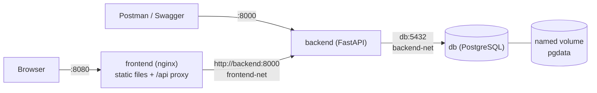

# Spendwise — Expense Tracker

> [!TIP]
> To see all works in this repository, please check the [master branch](../../tree/master).

> Project Part 1 — *Containerization of a Multi-Service Web Application* (Web Development, KBTU, Fall 2026)

## About the project

**Spendwise** is a web application for tracking personal expenses. A user records each
purchase (title, amount, date, category, optional note) and the app shows where the money
goes: monthly and all-time totals, a per-category breakdown and the latest expenses.

There are two kinds of accounts:

- **User**: manages only their own expenses.
- **Admin**: sees all users' expenses, maintains the shared list of categories and manages
  user accounts (change role, disable, delete).

The project shows how a typical three-tier application (UI → REST API → database) is
packaged into Docker containers and orchestrated with Docker Compose. The full stack starts
with **one command** and comes with **demo data** (5 users, ~240 expenses) so it can be
explored right away.

| Service    | Tech                                   | Image / Build         | Port (host → container) |
|------------|----------------------------------------|-----------------------|-------------------------|
| `frontend` | HTML + CSS + vanilla JS, served by Nginx | `frontend/Dockerfile` | `8080 → 80`             |
| `backend`  | FastAPI, SQLAlchemy (async), Alembic, JWT | `backend/Dockerfile`  | `8000 → 8000`           |
| `db`       | PostgreSQL 16                          | `postgres:16-alpine`  | not published           |

## Features

- **Auth:** register, login (JWT bearer token), logout (token revoked server-side), `GET /me`.
- **Roles:**
  - `user` manages only their own expenses.
  - `admin` sees every user's expenses, manages categories and users (change role, disable, delete).
- **Expenses CRUD:** list (pagination, search, category and date filters), get by ID, create, update, delete, and a per-category summary.
- **Categories CRUD:** everyone can read; only admins can write.
- **UI:** login/sign-up, a dashboard with stats and per-category bars, an expenses table with filters, modal forms, delete confirmations and toasts. Categories and Users admin pages.
- **Seeding:** on first start the backend creates an admin account, 7 default categories and demo data (see [Demo data](#demo-data)).

## Architecture



- The browser only talks to **nginx**. Requests to `/api/*` are reverse-proxied to `backend:8000`, so there are no CORS issues.
- There are two user-defined bridge networks:
  - `frontend-net`: frontend ↔ backend.
  - `backend-net`: backend ↔ db.

  The frontend container **cannot** reach the database.
- Services find each other by **service name** through Docker's embedded DNS (`backend`, `db`).
- `depends_on` with `condition: service_healthy` sets the startup order: db → backend → frontend.
- On startup, the backend runs `alembic upgrade head`, then starts uvicorn (`backend/entrypoint.sh`).
- PostgreSQL data lives in the named volume `pgdata`, so it survives `docker compose down` and container rebuilds.

## Getting started

### Prerequisites

- [Docker Desktop](https://www.docker.com/products/docker-desktop/) (or Docker Engine + Compose v2).
- Free host ports `8080` and `8000` (can be changed in `.env`).

### Run

```bash
# 1. (optional) create your own config; every variable has a default
cp .env.example .env

# 2. build images and start db -> backend -> frontend
docker compose up --build
```

The first start takes a minute: images are built, PostgreSQL is initialized, migrations are
applied and demo data is inserted. The app is ready when `docker compose ps` shows all three
services as `healthy`. Add `-d` to run in the background.

### Open

| What              | URL                                  |
|-------------------|--------------------------------------|
| Web UI            | http://localhost:8080                |
| Swagger UI        | http://localhost:8080/api/docs  (or http://localhost:8000/api/docs) |
| ReDoc             | http://localhost:8080/api/redoc      |
| OpenAPI JSON      | http://localhost:8080/api/openapi.json |

Log in with one of the [demo accounts](#demo-accounts) or create a new account on the **Sign up** tab.

### Stop / reset

```bash
docker compose ps                     # status + health
docker compose logs -f backend        # follow backend logs
docker compose exec db sh -c 'psql -U "$POSTGRES_USER" -d "$POSTGRES_DB"'   # SQL shell
docker compose down                   # stop (data kept in the pgdata volume)
docker compose down -v                # stop AND delete the database volume (fresh start)
```

## Demo data

When `SEED_DEMO_DATA=true` (the default), the backend fills the database on first start
(`backend/app/seed.py`):

| Data | Amount |
|---|---|
| Users | 1 admin + 5 demo users |
| Categories | 7 (Food, Transport, Housing, Entertainment, Health, Education, Other) |
| Expenses | ~240, spread over the last 6 months, realistic titles and amounts in KZT |

Seeding is idempotent: it is skipped if the demo users already exist, so restarts do not
duplicate data. To regenerate it, run `docker compose down -v && docker compose up`, or run
`docker compose exec backend python -m app.seed`.

### Demo accounts

| Email | Password | Role |
|---|---|---|
| `admin@example.com` | `admin12345` | admin |
| `aruzhan@example.com` | `demo12345` | user |
| `timur@example.com` | `demo12345` | user |
| `dana@example.com` | `demo12345` | user |
| `alikhan@example.com` | `demo12345` | user |
| `madina@example.com` | `demo12345` | user |

Passwords come from `ADMIN_PASSWORD` and `DEMO_USER_PASSWORD`.

## Environment variables

Docker Compose reads these from `.env`. The defaults are in `docker-compose.yml`.

| Variable | Default | Used by | Description |
|---|---|---|---|
| `FRONTEND_PORT` | `8080` | compose | Host port for the UI |
| `BACKEND_PORT` | `8000` | compose | Host port for the API |
| `POSTGRES_USER` / `POSTGRES_PASSWORD` / `POSTGRES_DB` | `expenses` | db, backend | DB credentials |
| `JWT_SECRET` | `dev-only-secret-change-me` | backend | Secret used to sign JWTs |
| `ACCESS_TOKEN_EXPIRE_MINUTES` | `60` | backend | Token lifetime |
| `ADMIN_EMAIL` / `ADMIN_PASSWORD` | `admin@example.com` / `admin12345` | backend | Seeded admin account |
| `SEED_DEMO_DATA` | `true` | backend | Insert demo users and expenses on first start |
| `DEMO_USER_PASSWORD` | `demo12345` | backend | Password for all demo users |
| `CORS_ORIGINS` | `http://localhost:8080` | backend | Allowed origins for direct API calls |
| `BACKEND_URL` | `http://backend:8000` | frontend | Upstream address for the nginx proxy, set via `envsubst` template |

## API documentation

The API is documented with OpenAPI 3.1, generated by FastAPI:

- **Swagger UI** at **`/api/docs`**: interactive; every endpoint has a description, request/response
  schemas with examples, parameter descriptions and the possible error codes. Authorization is
  remembered between page reloads.
- **ReDoc** at **`/api/redoc`**: read-only reference.

To try protected endpoints in Swagger:

1. Call `POST /api/auth/login` (the example body already contains the admin credentials).
2. Click **Authorize**.
3. Paste the `access_token`.

All protected endpoints require the `Authorization: Bearer <token>` header.

| Method | Endpoint | Auth | Description |
|---|---|---|---|
| GET | `/api/health` | — | Liveness + DB check |
| POST | `/api/auth/register` | — | Create account `{email, full_name, password}` → `201` |
| POST | `/api/auth/login` | — | `{email, password}` → `{access_token, token_type, expires_in}` |
| POST | `/api/auth/logout` | user | Revoke current token |
| GET | `/api/auth/me` | user | Current user |
| GET | `/api/expenses` | user | List. Query params: `q, category_id, date_from, date_to, owner_id (admin), limit, offset` |
| GET | `/api/expenses/summary` | user | Totals by category (`date_from`, `date_to`) |
| GET | `/api/expenses/{id}` | owner/admin | Get by ID |
| POST | `/api/expenses` | user | Create `{title, amount, spent_on, category_id?, note?}` → `201` |
| PUT | `/api/expenses/{id}` | owner/admin | Update |
| DELETE | `/api/expenses/{id}` | owner/admin | Delete → `204` |
| GET | `/api/categories` | user | List |
| GET | `/api/categories/{id}` | user | Get by ID |
| POST | `/api/categories` | admin | Create `{name, color}` → `201` |
| PUT | `/api/categories/{id}` | admin | Update |
| DELETE | `/api/categories/{id}` | admin | Delete. Linked expenses become uncategorized |
| GET | `/api/users` | admin | List users |
| GET | `/api/users/{id}` | admin | Get user |
| PATCH | `/api/users/{id}` | admin | Update `{full_name?, role?, is_active?}` |
| DELETE | `/api/users/{id}` | admin | Delete user and their expenses |

Status codes:

| Code | Meaning |
|---|---|
| `401` | Missing, invalid, expired or revoked token |
| `403` | Not an admin |
| `404` | Not found. Also returned for another user's expense. |
| `409` | Duplicate email or category name |
| `422` | Validation error |

### Postman

Import `postman/ExpenseTracker.postman_collection.json` and run it with the **Collection Runner**. It has 34 requests with test assertions and walks the full flow:

1. Register and log in.
2. Category CRUD.
3. Expense CRUD.
4. Admin user management.
5. Permission checks: 401, 403 and 404.
6. Log out and clean up.

Variables (`baseUrl`, `adminEmail`, `adminPassword`) are set at the collection level.

From the CLI:

```bash
npx newman run postman/ExpenseTracker.postman_collection.json
```

## Project structure

```
.
├── docker-compose.yml          # 3 services, 2 networks, 1 named volume
├── .env.example
├── backend/
│   ├── Dockerfile              # multi-stage (uv builder → slim runtime), non-root user, healthcheck
│   ├── entrypoint.sh           # alembic upgrade head && uvicorn
│   ├── pyproject.toml, uv.lock
│   ├── alembic.ini, alembic/   # DB migrations
│   └── app/
│       ├── main.py             # FastAPI app, OpenAPI metadata, CORS, routers
│       ├── seed.py             # admin, categories and demo data (python -m app.seed)
│       ├── settings.py         # env-based config (pydantic-settings)
│       ├── db.py               # async engine/session
│       ├── models.py           # SQLAlchemy models
│       ├── schemas.py          # Pydantic request/response models
│       ├── security.py         # bcrypt hashing, JWT encode/decode
│       ├── deps.py             # auth dependencies (current user, admin guard)
│       └── routers/            # auth, expenses, categories, users
├── frontend/
│   ├── Dockerfile              # nginx:alpine + static files
│   ├── nginx/default.conf.template   # static serving + /api reverse proxy
│   └── public/                 # index.html, css/, js/ (api.js, app.js)
└── postman/ExpenseTracker.postman_collection.json
```

## Local backend development (without Docker)

```bash
docker compose up -d db                       # or any local Postgres
cd backend && uv sync
POSTGRES_HOST=localhost uv run alembic upgrade head
POSTGRES_HOST=localhost uv run uvicorn app.main:app --reload
```

Running the backend locally like this requires publishing the DB port. Add `ports: ["5432:5432"]` to the `db` service temporarily.

## Troubleshooting

| Problem | Fix |
|---|---|
| `backend` is unhealthy, logs show `password authentication failed` | `POSTGRES_*` changed after the volume was created. Postgres applies credentials only on first init, so run `docker compose down -v` and start again. |
| `port is already allocated` | Change `FRONTEND_PORT` / `BACKEND_PORT` in `.env`. |
| UI shows "Session expired" | The token expired or was revoked. Log in again. |
| No demo data | Make sure `SEED_DEMO_DATA=true`, then run `docker compose exec backend python -m app.seed`. |
