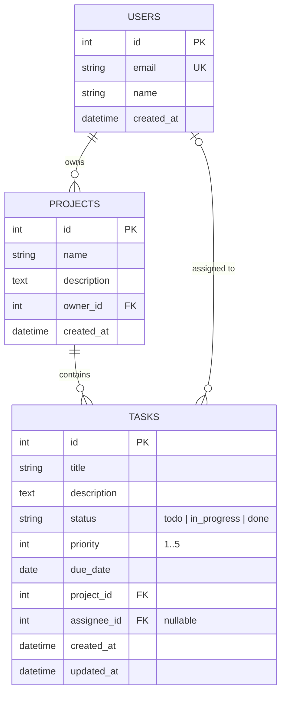

## HW3. REST API with a Relational Database

> [!TIP]
> To see all works in this repository, please check the [master branch](../../tree/master).

> [!NOTE]
> This homework is built on top of HW2 (FastAPI + PostgreSQL + Docker Compose), so in the git log it looks like a continuation.

### Homework task

- At least 3 related data models/entities.
- At least 2 relationships between models, including at least one one-to-many relationship.
- Relational database + ORM.
- At least 10 API endpoints with GET, POST, PUT/PATCH and DELETE.
- Endpoints that work with related data (e.g. `/users/{id}/projects`).
- Request validation and appropriate HTTP status/error responses.
- Documentation of all endpoints.
- Postman Collection with working requests for all endpoints.

### Stack

- **FastAPI** (backend framework), **PostgreSQL 13** (relational DB)
- **SQLAlchemy 2 (async)** ORM, **Alembic** migrations, **Pydantic v2** validation
- **Docker Compose** to run the app and the database

### Data model



| Relationship               | Type        | On delete                                   |
|----------------------------|-------------|---------------------------------------------|
| User → Projects (owner)    | one-to-many | deleting a user deletes their projects      |
| Project → Tasks            | one-to-many | deleting a project deletes its tasks        |
| User → Tasks (assignee)    | one-to-many | deleting a user un-assigns their tasks      |

Code: models in [src/db.py](src/db.py), request/response schemas in [src/schemas.py](src/schemas.py),
endpoints in [src/routers/](src/routers), migration in [alembic/versions/](alembic/versions).

### How to run

1. Create `.env` – copy `.env.example` to `.env`.
2. Start the database and apply migrations:

```bash
docker compose up -d db
pip install uv
uv sync --no-dev
alembic upgrade head
```

3. Run the application:

```bash
docker compose up --build
```

4. Swagger UI: `http://localhost:8000/docs`

5. Run the Postman collection (or import it into Postman):

```bash
npx newman run postman/TaskTracker.postman_collection.json
```

The collection ([postman/TaskTracker.postman_collection.json](postman/TaskTracker.postman_collection.json)) contains
32 requests (all endpoints + error cases) with tests. Requests are chained through collection variables
(`userId`, `assigneeId`, `projectId`, `taskId`), so run them top to bottom. `baseUrl` defaults to `http://localhost:8000`.

---

## API documentation

Base URL: `http://localhost:8000`. All request/response bodies are JSON.

### Errors

| Status | When                                                                                   | Body                                                |
|--------|----------------------------------------------------------------------------------------|-----------------------------------------------------|
| `404`  | Resource from the URL path does not exist                                             | `{"detail": "User 42 not found"}`                   |
| `409`  | Email already used by another user                                                     | `{"detail": "User with this email already exists"}` |
| `422`  | Body/query/path validation failed, unknown fields, empty PATCH, referenced id missing | `{"detail": [...]}` or `{"detail": "Owner 42 does not exist"}` |
| `500`  | Unexpected server error                                                               | `{"detail": "Internal Server Error"}`               |

### Validation rules

- Path ids must be positive integers.
- Unknown body fields are rejected.
- `email` – valid email format, max 255, stored lowercase, unique.
- `name` / `title` – 1..255 chars (whitespace trimmed).
- `description` – up to 5000 chars, nullable.
- `status` – one of `todo`, `in_progress`, `done` (default `todo`).
- `priority` – integer 1..5 (default `3`).
- `due_date` – `YYYY-MM-DD`, nullable.
- PATCH bodies need at least one field; required fields (e.g. `name`, `title`, `status`) cannot be set to `null`.
- Pagination: `limit` 1..100 (default 50), `offset` ≥ 0 (default 0).

### Endpoints overview

| #  | Method | URL                          | Description                       | Success |
|----|--------|------------------------------|-----------------------------------|---------|
| 0  | GET    | `/health`                    | Health check                      | 200     |
| 1  | GET    | `/users`                     | List users                        | 200     |
| 2  | POST   | `/users`                     | Create user                       | 201     |
| 3  | GET    | `/users/{user_id}`           | Get user                          | 200     |
| 4  | PATCH  | `/users/{user_id}`           | Update user                       | 200     |
| 5  | DELETE | `/users/{user_id}`           | Delete user (cascade)             | 204     |
| 6  | GET    | `/users/{user_id}/projects`  | Projects owned by user            | 200     |
| 7  | GET    | `/users/{user_id}/tasks`     | Tasks assigned to user            | 200     |
| 8  | GET    | `/projects`                  | List projects                     | 200     |
| 9  | POST   | `/projects`                  | Create project                    | 201     |
| 10 | GET    | `/projects/{project_id}`     | Get project with owner and count  | 200     |
| 11 | PATCH  | `/projects/{project_id}`     | Update project                    | 200     |
| 12 | DELETE | `/projects/{project_id}`     | Delete project (cascade)          | 204     |
| 13 | GET    | `/projects/{project_id}/tasks` | Tasks of project                | 200     |
| 14 | POST   | `/projects/{project_id}/tasks` | Create task in project          | 201     |
| 15 | GET    | `/tasks`                     | List tasks with filters           | 200     |
| 16 | GET    | `/tasks/{task_id}`           | Get task                          | 200     |
| 17 | PATCH  | `/tasks/{task_id}`           | Update / move / (un)assign task   | 200     |
| 18 | DELETE | `/tasks/{task_id}`           | Delete task                       | 204     |

### Health

#### `GET /health`

Response `200`:

```json
{ "status": "ok", "timestamp": "2026-11-09T15:19:22.539533+00:00" }
```

### Users

`User` object:

```json
{ "id": 1, "email": "alice@example.com", "name": "Alice", "created_at": "2026-11-09T15:20:00.000000Z" }
```

#### `GET /users`

Query: `limit` (int, 1..100, default 50), `offset` (int, ≥0, default 0).
Response `200`: `User[]`. Errors: `422`.

#### `POST /users`

Body:

```json
{ "email": "alice@example.com", "name": "Alice" }
```

Response `201`: `User`. Errors: `409` email taken, `422` validation.

#### `GET /users/{user_id}`

Response `200`: `User`. Errors: `404`, `422`.

#### `PATCH /users/{user_id}`

Body (any subset, at least one field):

```json
{ "email": "new@example.com", "name": "Alice Updated" }
```

Response `200`: `User`. Errors: `404`, `409`, `422`.

#### `DELETE /users/{user_id}`

Deletes the user, their projects and those projects' tasks; tasks assigned to the user become unassigned.
Response `204` (no body). Errors: `404`, `422`.

#### `GET /users/{user_id}/projects`

Response `200`: `Project[]` owned by the user. Errors: `404`, `422`.

#### `GET /users/{user_id}/tasks`

Query: `status` (optional, `todo | in_progress | done`).
Response `200`: `Task[]` assigned to the user. Errors: `404`, `422`.

### Projects

`Project` object:

```json
{ "id": 1, "name": "Website redesign", "description": "Q4 marketing site", "owner_id": 1, "created_at": "2026-11-09T15:20:00Z" }
```

#### `GET /projects`

Query: `owner_id` (optional, int > 0), `limit`, `offset`.
Response `200`: `Project[]`. Errors: `422`.

#### `POST /projects`

Body:

```json
{ "name": "Website redesign", "description": "Q4 marketing site", "owner_id": 1 }
```

`description` is optional. Response `201`: `Project`. Errors: `422` validation or owner does not exist.

#### `GET /projects/{project_id}`

Response `200` – project with nested owner and number of tasks:

```json
{
  "id": 1, "name": "Website redesign", "description": "Q4 marketing site", "owner_id": 1,
  "created_at": "2026-11-09T15:20:00Z",
  "owner": { "id": 1, "email": "alice@example.com", "name": "Alice", "created_at": "..." },
  "task_count": 3
}
```

Errors: `404`, `422`.

#### `PATCH /projects/{project_id}`

Body (any subset; `description` may be `null`; `owner_id` transfers ownership):

```json
{ "name": "Website redesign v2", "description": null, "owner_id": 2 }
```

Response `200`: `Project`. Errors: `404`, `422` (validation / new owner does not exist).

#### `DELETE /projects/{project_id}`

Deletes the project and all its tasks. Response `204`. Errors: `404`, `422`.

#### `GET /projects/{project_id}/tasks`

Query: `status` (optional). Response `200`: `Task[]`. Errors: `404`, `422`.

#### `POST /projects/{project_id}/tasks`

Body (only `title` is required):

```json
{
  "title": "Design mockups",
  "description": "Landing + pricing pages",
  "status": "todo",
  "priority": 4,
  "due_date": "2026-12-01",
  "assignee_id": 2
}
```

Response `201`: `Task`. Errors: `404` project not found, `422` validation or assignee does not exist.

### Tasks

`Task` object:

```json
{
  "id": 1, "title": "Design mockups", "description": "Landing + pricing pages",
  "status": "todo", "priority": 4, "due_date": "2026-12-01",
  "project_id": 1, "assignee_id": 2,
  "created_at": "2026-11-09T15:20:00Z", "updated_at": "2026-11-09T15:20:00Z"
}
```

#### `GET /tasks`

Query: `status`, `project_id`, `assignee_id` (all optional), `limit`, `offset`.
Response `200`: `Task[]`. Errors: `422`.

#### `GET /tasks/{task_id}`

Response `200`: `Task`. Errors: `404`, `422`.

#### `PATCH /tasks/{task_id}`

Body (any subset; `project_id` moves the task, `assignee_id: null` un-assigns it):

```json
{ "status": "in_progress", "priority": 5, "assignee_id": null }
```

Response `200`: `Task`. Errors: `404`, `422` (validation / project or assignee does not exist).

#### `DELETE /tasks/{task_id}`

Response `204`. Errors: `404`, `422`.
