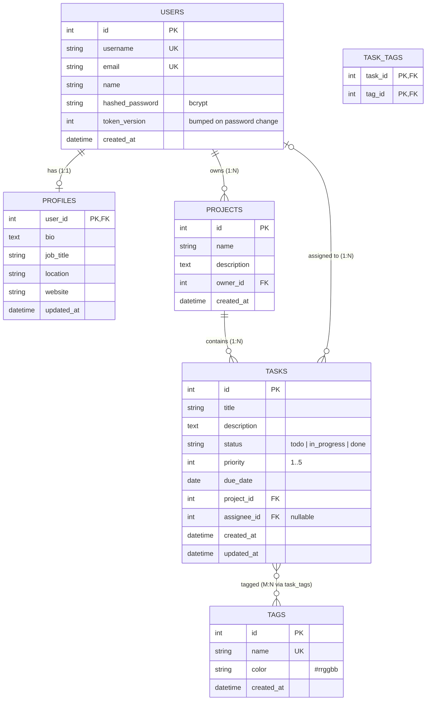

## HW4. Authentication (JWT) + React frontend

> [!TIP]
> To see all works in this repository, please check the [master branch](../../tree/master).

> [!NOTE]
> This homework is built on top of HW3 (FastAPI + PostgreSQL + Alembic), so in the git log it looks like a continuation.

### Homework task

- At least 3 entities with meaningful **one-to-one**, **one-to-many** and **many-to-many** relationships; every table prepopulated with at least 10 records.
- Full CRUD for the entities. Public `GET` endpoints; `POST`, `PUT`, `PATCH`, `DELETE` require authentication.
- Signup, login and JWT authentication.
- Frontend with at least 2 protected routes: **Profile** and one meaningful REST API feature available only to logged-in users.
- Display current user information, update username, change password.
- Handle API errors, loading states and JWT tokens.
- Frontend, backend and database run as separate services with Docker Compose.
- README with setup instructions + Postman Collection.

### Stack

| Service    | Tech                                                                                     | Port                    |
|------------|------------------------------------------------------------------------------------------|-------------------------|
| `db`       | PostgreSQL 13                                                                            | `5432`                  |
| `backend`  | FastAPI, SQLAlchemy 2 (async), Alembic, Pydantic v2, PyJWT, bcrypt                       | `8000`                  |
| `frontend` | React 18 + React Router 6 (Vite build), served by nginx which proxies `/api/*` → backend | `3000`                  |

### Quick start (Docker Compose)

```bash
cp .env.example .env            # then set JWT_SECRET_KEY to a long random string
docker compose up --build
```

| What                      | URL                                                      |
|---------------------------|----------------------------------------------------------|
| Frontend                  | http://localhost:3000                                    |
| Backend API / Swagger UI  | http://localhost:8000 / http://localhost:8000/docs      |
| Backend through frontend  | http://localhost:3000/api/... (nginx proxy, no CORS)    |

On start the backend runs `alembic upgrade head`, which creates the schema **and seeds demo data**.

**Demo accounts** – all 12 seeded users have the password `password123`, e.g.
`alina.kim`, `aruzhan.sadykova`, `daniyar.nurlanov`, `timur.akhmetov`, ... (see `GET /users`).

> To start from a clean database: `docker compose down -v && docker compose up --build`.

### Local development (without Docker for backend / frontend)

```bash
docker compose up -d db
uv sync
POSTGRES_HOST=localhost uv run alembic upgrade head
POSTGRES_HOST=localhost uv run python src/main.py         # http://localhost:8000

cd frontend && npm install && npm run dev                 # http://localhost:5173 (proxies /api → :8000)
```

### Postman

[postman/TaskTracker.postman_collection.json](postman/TaskTracker.postman_collection.json) – **82 requests / 105 tests**
covering every endpoint plus error cases (401, 403, 404, 409, 422) and the full auth flow
(signup → login → refresh → change password → old token revoked → delete account).

- Collection-level auth is `Bearer {{accessToken}}`; **Login** stores `accessToken` / `refreshToken` automatically.
- Requests are chained through collection variables – run them top to bottom (Collection Runner) or:

```bash
npx newman run postman/TaskTracker.postman_collection.json
```

Every run creates its own users/tags (random suffix) and deletes them in the *Cleanup* folder.

---

## Data model



| Relationship               | Type         | On delete                                     |
|----------------------------|--------------|-----------------------------------------------|
| User ↔ Profile             | one-to-one   | deleting a user deletes the profile           |
| User → Projects (owner)    | one-to-many  | deleting a user deletes their projects        |
| Project → Tasks            | one-to-many  | deleting a project deletes its tasks          |
| User → Tasks (assignee)    | one-to-many  | deleting a user un-assigns their tasks        |
| Task ↔ Tags                | many-to-many | deleting a task/tag removes only the links    |

**Seed data** ([7c1e5d8f2a90](alembic/versions/7c1e5d8f2a90_seed_demo_data.py), [b9e2c7d4f1a6](alembic/versions/b9e2c7d4f1a6_seed_profiles_and_tags.py)):
12 users, 12 profiles, 15 projects, 150 tasks, 12 tags, ~300 task↔tag links.

Code: models in [src/db.py](src/db.py), schemas in [src/schemas.py](src/schemas.py), JWT/bcrypt in [src/security.py](src/security.py),
auth dependency in [src/dependencies.py](src/dependencies.py), endpoints in [src/routers/](src/routers), frontend in [frontend/src/](frontend/src).

## Authentication

- `POST /auth/signup` creates a user (password hashed with **bcrypt**).
- `POST /auth/login` returns an **access token** (15 min) and a **refresh token** (7 days) – HS256 JWTs with claims
  `sub` (user id), `type` (`access`/`refresh`), `ver` (token version), `iat`, `exp`.
- Protected endpoints need `Authorization: Bearer <access_token>`; missing/invalid/expired token → `401` with `WWW-Authenticate: Bearer`.
- `POST /auth/refresh` exchanges a refresh token for a new pair (an access token is rejected there, and vice versa).
- `PUT /me/password` increments `token_version` → **all previously issued tokens are revoked**; the response contains a fresh pair.
- Authorization (403): only the project owner may edit/delete a project or create/delete its tasks;
  a task may be edited by the project owner or its assignee; users can modify only their own account/profile.

## Frontend

| Route                 | Access      | What it does                                                                                      |
|-----------------------|-------------|---------------------------------------------------------------------------------------------------|
| `/`                   | public      | All projects with owners (public `GET`s)                                                          |
| `/login`, `/signup`   | guests only | Login / registration forms with validation errors from the API                                    |
| `/profile`            | 🔒 protected | Current user info, **update username** (and name/email), **change password**, create/edit/delete profile (1:1), delete account |
| `/my-projects`        | 🔒 protected | CRUD for own projects + table of tasks assigned to me with inline status change                   |
| `/projects/:id`       | 🔒 protected | Kanban board: create / edit (PUT) / move (PATCH) / delete tasks, assign users, attach tags (M:N)  |
| `/tags`               | 🔒 protected | CRUD for tags                                                                                     |

How the frontend handles JWT, errors and loading ([api.js](frontend/src/api.js), [AuthContext.jsx](frontend/src/AuthContext.jsx)):

- Tokens are kept in `localStorage`; every request gets `Authorization: Bearer ...`.
- On `401` the client transparently calls `/auth/refresh` once (single-flight) and retries; if refresh fails the tokens are
  dropped and the user is sent to `/login` with a *"session expired"* message, then returned to the page they came from.
- `<ProtectedRoute>` redirects guests to `/login`; `<GuestRoute>` keeps logged-in users away from login/signup.
- FastAPI errors (`{"detail": "..."}` or Pydantic validation lists) are converted to readable messages; network errors are reported too.
- Every request shows a loading state (spinner / disabled button with *"Saving..."*), errors are shown inline with *Retry* where useful.

---

## API documentation

Base URL: `http://localhost:8000` (or `http://localhost:3000/api` through the frontend). JSON everywhere.
Interactive docs: `/docs` (click **Authorize** and paste an access token).

🔒 = requires `Authorization: Bearer <access_token>`.

### Errors

| Status | When                                                                       | Body example                                         |
|--------|----------------------------------------------------------------------------|------------------------------------------------------|
| `400`  | Wrong current password on password change                                  | `{"detail": "Current password is incorrect"}`        |
| `401`  | Missing / invalid / expired / revoked token, wrong login credentials       | `{"detail": "Not authenticated"}`                    |
| `403`  | Authenticated, but not the owner of the resource                           | `{"detail": "Only the project owner can do this"}`   |
| `404`  | Resource from the URL path does not exist                                  | `{"detail": "Project 42 not found"}`                 |
| `409`  | Username / email / tag name already taken, profile already exists          | `{"detail": "User with this username already exists"}` |
| `422`  | Body/path/query validation failed, unknown fields, referenced id missing   | `{"detail": [...]}` or `{"detail": "Tags [99] do not exist"}` |
| `500`  | Unexpected server error                                                    | `{"detail": "Internal Server Error"}`                |

### Validation rules

- `username` – 3..50 chars `[a-z0-9._-]`, stored lowercase, unique. `email` – valid, stored lowercase, unique.
- `password` – 8..72 characters (bcrypt limit); the new password must differ from the current one.
- `name` / `title` – 1..255 chars; `description` / `bio` – up to 5000; `job_title` / `location` – up to 100; `website` – `http(s)://...`.
- `status` – `todo | in_progress | done`; `priority` – 1..5; `due_date` – `YYYY-MM-DD`.
- Tag `name` – 1..50 chars, unique; `color` – `#rrggbb`. `tag_ids` – up to 20 ids (duplicates ignored).
- Unknown body fields are rejected. PATCH bodies need at least one field.
- **PUT** replaces all editable fields (omitted optional fields are reset to defaults); **PATCH** changes only the sent fields.

### Endpoints overview

| #  | Method | URL                             | Auth | Description                                 | Success |
|----|--------|---------------------------------|------|---------------------------------------------|---------|
| 0  | GET    | `/health`                       |      | Health check                                | 200     |
| 1  | POST   | `/auth/signup`                  |      | Register                                    | 201     |
| 2  | POST   | `/auth/login`                   |      | Get access + refresh tokens                 | 200     |
| 3  | POST   | `/auth/refresh`                 |      | Refresh token pair                          | 200     |
| 4  | GET    | `/me`                           | 🔒   | Current user (+ email, profile)             | 200     |
| 5  | PUT    | `/me`                           | 🔒   | Replace username, email, name               | 200     |
| 6  | PATCH  | `/me`                           | 🔒   | Update username / email / name              | 200     |
| 7  | DELETE | `/me`                           | 🔒   | Delete own account                          | 204     |
| 8  | PUT    | `/me/password`                  | 🔒   | Change password (revokes old tokens)        | 200     |
| 9  | GET    | `/me/projects`                  | 🔒   | My projects                                 | 200     |
| 10 | GET    | `/me/tasks`                     | 🔒   | Tasks assigned to me                        | 200     |
| 11 | GET    | `/me/profile`                   | 🔒   | My profile                                  | 200     |
| 12 | POST   | `/me/profile`                   | 🔒   | Create my profile                           | 201     |
| 13 | PUT    | `/me/profile`                   | 🔒   | Replace my profile                          | 200     |
| 14 | PATCH  | `/me/profile`                   | 🔒   | Update my profile                           | 200     |
| 15 | DELETE | `/me/profile`                   | 🔒   | Delete my profile                           | 204     |
| 16 | GET    | `/users`                        |      | List users                                  | 200     |
| 17 | GET    | `/users/{id}`                   |      | Get user                                    | 200     |
| 18 | GET    | `/users/{id}/profile`           |      | User's profile                              | 200     |
| 19 | GET    | `/users/{id}/projects`          |      | Projects owned by user                      | 200     |
| 20 | GET    | `/users/{id}/tasks`             |      | Tasks assigned to user                      | 200     |
| 21 | GET    | `/projects`                     |      | List projects                               | 200     |
| 22 | POST   | `/projects`                     | 🔒   | Create project (owner = current user)       | 201     |
| 23 | GET    | `/projects/{id}`                |      | Project with owner and task count           | 200     |
| 24 | PUT    | `/projects/{id}`                | 🔒 owner | Replace project                         | 200     |
| 25 | PATCH  | `/projects/{id}`                | 🔒 owner | Update / transfer ownership             | 200     |
| 26 | DELETE | `/projects/{id}`                | 🔒 owner | Delete project (cascade tasks)          | 204     |
| 27 | GET    | `/projects/{id}/tasks`          |      | Tasks of project                            | 200     |
| 28 | POST   | `/projects/{id}/tasks`          | 🔒 owner | Create task in project                  | 201     |
| 29 | GET    | `/tasks`                        |      | List tasks                                  | 200     |
| 30 | GET    | `/tasks/{id}`                   |      | Get task (with tags)                        | 200     |
| 31 | PUT    | `/tasks/{id}`                   | 🔒 owner/assignee | Replace task                   | 200     |
| 32 | PATCH  | `/tasks/{id}`                   | 🔒 owner/assignee | Update / move / (un)assign / retag | 200 |
| 33 | DELETE | `/tasks/{id}`                   | 🔒 owner | Delete task                             | 204     |
| 34 | GET    | `/tags`                         |      | List tags                                   | 200     |
| 35 | POST   | `/tags`                         | 🔒   | Create tag                                  | 201     |
| 36 | GET    | `/tags/{id}`                    |      | Get tag                                     | 200     |
| 37 | PUT    | `/tags/{id}`                    | 🔒   | Replace tag                                 | 200     |
| 38 | PATCH  | `/tags/{id}`                    | 🔒   | Update tag                                  | 200     |
| 39 | DELETE | `/tags/{id}`                    | 🔒   | Delete tag (removed from tasks)             | 204     |
| 40 | GET    | `/tags/{id}/tasks`              |      | Tasks with this tag                         | 200     |

`GET /users`, `/projects`, `/tasks` optionally accept `limit` (1..100, default 50) / `offset`; `/tasks` and `*/tasks`
also accept `status`. None of them are required.

### Auth

#### `POST /auth/signup`

```json
{ "username": "alice", "email": "alice@example.com", "name": "Alice", "password": "secret123" }
```

Response `201`: `User` (public, see below). Errors: `409`, `422`.

#### `POST /auth/login`

```json
{ "username": "alice", "password": "secret123" }
```

Response `200`:

```json
{ "access_token": "eyJhbGciOi...", "refresh_token": "eyJhbGciOi...", "token_type": "bearer", "expires_in": 900 }
```

Errors: `401` invalid username or password, `422`.

#### `POST /auth/refresh`

```json
{ "refresh_token": "eyJhbGciOi..." }
```

Response `200`: new token pair. Errors: `401` invalid/expired/revoked refresh token.

### Current user (`/me`) 🔒

`GET /me` → `200`:

```json
{
  "id": 3, "username": "alina.kim", "name": "Alina Kim", "email": "alina.kim@demo.example.com",
  "created_at": "2026-11-24T12:00:00Z",
  "profile": { "user_id": 3, "bio": "...", "job_title": "UI/UX Designer", "location": "Almaty",
               "website": "https://alina-kim.dev", "updated_at": "..." }
}
```

- `PATCH /me` – e.g. `{ "username": "alina.k" }` → `200` updated `/me`. Errors: `409`, `422`.
- `PUT /me` – `{ "username": "...", "email": "...", "name": "..." }` (all required).
- `DELETE /me` → `204`.
- `PUT /me/password` – `{ "current_password": "password123", "new_password": "newsecret123" }` → `200` new token pair.
  Errors: `400` wrong current password, `422` too short / same as current.
- `GET /me/projects`, `GET /me/tasks` → arrays of `Project` / `Task`.

#### Profile (1:1) – `/me/profile` 🔒

Body for `POST` / `PUT` (all fields optional, `PUT` resets omitted ones to `null`), any subset for `PATCH`:

```json
{ "bio": "Backend developer", "job_title": "Engineer", "location": "Almaty", "website": "https://example.com" }
```

`POST` → `201` (`409` if exists), `GET`/`PUT`/`PATCH` → `200` (`404` if not created), `DELETE` → `204`.
Public read: `GET /users/{id}/profile`.

### Users (public)

`User` object (email is visible only at `/me`):

```json
{ "id": 1, "username": "aruzhan.sadykova", "name": "Aruzhan Sadykova", "created_at": "2026-11-24T12:00:00Z" }
```

### Projects

`Project`: `{ "id": 1, "name": "Website redesign", "description": "...", "owner_id": 1, "created_at": "..." }`.
`GET /projects/{id}` additionally returns `"owner": User` and `"task_count": 10`.

- `POST /projects` 🔒 – `{ "name": "Website redesign", "description": "Q4 marketing site" }` → `201`, owner is the current user.
- `PUT /projects/{id}` 🔒 owner – `{ "name": "...", "description": null }`.
- `PATCH /projects/{id}` 🔒 owner – any subset of `name`, `description`, `owner_id` (transfer ownership).
- `DELETE /projects/{id}` 🔒 owner → `204`.

### Tasks

`Task` object:

```json
{
  "id": 1, "title": "Design mockups", "description": "Landing + pricing pages",
  "status": "todo", "priority": 4, "due_date": "2026-12-01",
  "project_id": 1, "assignee_id": 2,
  "tags": [ { "id": 1, "name": "bug", "color": "#ef4444", "created_at": "..." } ],
  "created_at": "...", "updated_at": "..."
}
```

- `POST /projects/{id}/tasks` 🔒 project owner (only `title` required):

```json
{ "title": "Design mockups", "description": "Landing + pricing pages", "status": "todo",
  "priority": 4, "due_date": "2026-12-01", "assignee_id": 2, "tag_ids": [1, 4] }
```

- `PUT /tasks/{id}` 🔒 owner/assignee – same body as create (project stays the same).
- `PATCH /tasks/{id}` 🔒 owner/assignee – any subset, plus `project_id` (move; you must own both projects);
  `assignee_id: null` un-assigns, `tag_ids: []` removes all tags.
- `DELETE /tasks/{id}` 🔒 project owner → `204`.

### Tags (M:N with tasks)

`Tag`: `{ "id": 1, "name": "bug", "color": "#ef4444", "created_at": "..." }`.

- `POST /tags` / `PUT /tags/{id}` 🔒 – `{ "name": "bug", "color": "#ef4444" }` (`color` defaults to `#6b7280`). `409` on duplicate name.
- `PATCH /tags/{id}` 🔒 – any subset. `DELETE /tags/{id}` 🔒 → `204`.
- `GET /tags/{id}/tasks` – tasks that have this tag.
